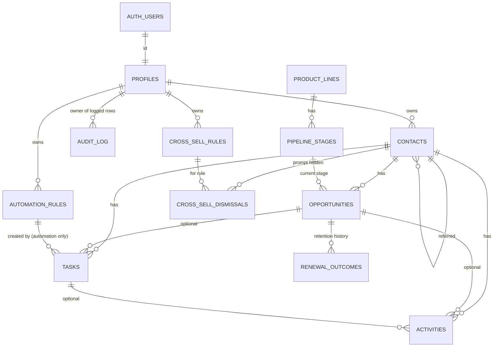

# Data model

Source of truth: `supabase/migrations/`. This page explains it; if they disagree, the
migrations win and this page needs fixing.

## Entity relationships

Every business table carries `owner_id`. Foreign keys between business tables include
`owner_id` (or `contact_id`), so a record can never point at another agent's contact,
or at an opportunity that belongs to a different contact.

## Tables

### profiles
One per authorized user (`id` = `auth.users.id`). `display_name`, `time_zone` (US zones,
default `America/New_York`), `google_review_url` (https only; used in review requests).
Users may edit only those three columns of their own row.
Profiles are created automatically by a trigger when Supabase Auth adds a user (display name
from user metadata, else the part of the email before @), which in turn inserts the 12 default
automation rules. Every table also has a restrictive policy requiring a two-step (aal2)
session (ADR-016).

### product_lines / pipeline_stages (reference data)
Four product lines: auto, home, commercial, life. Stages per line with `position` and
`kind` (`active` | `won` | `lost`), seeded exactly as spec §9 and mirrored in
`src/lib/pipelines.ts`. Read-only for users; changed only by migrations.

### contacts
Individuals and businesses. Name rule: an individual needs a first or last name; a business
needs a business name. Email, phone, address (2-letter state, US ZIP), preferred contact
method, lead source (free text), `relationship_status` (prospect | client | former_client),
`referred_by_contact_id` (another of the same agent's contacts; never itself),
`google_review_left_on` (recorded by the agent), notes (≤ 5,000 chars), `archived_at`
(archive instead of delete). Phase 17: `tags` (text array: ≤ 20 tags of 1–40 characters, no
repeats ignoring case; checked by a trigger) and `merged_into_contact_id` (set when merged into
another contact; such a contact stays archived and cannot be un-merged).

### opportunities
Many per contact, in any mix of product lines.

| Column | Meaning |
|---|---|
| `product_line`, `stage_id` | Stage must belong to the same product line (composite FK). |
| `stage_kind` | Copied from the stage by trigger; used by the consistency check. |
| `outcome` | `open` / `nurture` on active stages; `won` only on the won stage (Bound, or Placed for life); `lost` only on Lost. |
| `loss_reason`, `loss_reason_detail` | Reason required exactly when the outcome is `lost`. |
| `closed_at` | Set automatically when won or lost; cleared on reopen. |
| `cycle` | Starts at 1; incremented on reopen so a new follow-up sequence gets new task keys. |
| `quote_sent_on`, `estimated_annual_premium`, `quoted_carrier`, `next_action`, `effective_date`, `renewal_date` | Quote tracking and dates. Renewal must be after effective. Carrier is free text (≤ 100). |

Lifecycle rules (trigger `opportunities_b_lifecycle`, Phase 4): the product line cannot change
after creation; `cycle` is set by the database only (1 on insert, +1 when a won or lost
opportunity is reopened, otherwise unchanged); reopening a lost opportunity clears its loss
reason and detail (the audit log keeps them).

A life application in "Application Process" or "Decision Pending" can never be marked won.

Policies (Phase 8, ADR-023): a won opportunity is a client policy. `policy_term_months` is 12,
or 6 for auto only; it sets how far "renewed" moves the renewal date. `policy_ended_on` is set
when a renewal is recorded as lost (allowed only while won; cleared if the opportunity is
reopened). A won opportunity with no end date is an **active policy**.

### tasks
Contact required; opportunity optional (must belong to the same contact). `due_date` is a
calendar date; optional `start_date` (≤ due date) hides the task from current work until then.
`category` prospecting/onboarding/renewal/review_request/referral_request/other.
`priority` low/normal/high. `status` open/completed/cancelled, with
`completed_at` / `cancelled_at` maintained by trigger. `origin` manual/automation:
automation tasks must carry `automation_rule_id` and `dedupe_key`; manual tasks carry
neither. `(owner_id, dedupe_key)` is unique, so a retried automation event updates the
existing task instead of creating another (ADR-008). `due_date_overridden` marks a date the
owner changed, so automation leaves it alone.

### activities
Contact history: type (call, meeting, note, email, text_message, follow_up, quote,
review_request, referral_request, other); outcomes include review_left, referral_received, declined;
`occurred_at`, optional outcome, optional link to an opportunity and/or task, notes.
`requested_follow_up_on` is allowed only with the outcome `requested_follow_up`.

### automation_rules
Per-user rule configuration, executed in Phase 6: trigger event, action (create task, close
prospecting tasks, create checklist), anchor date (event, requested, renewal), offset in
calendar or business days, task title, priority, task category, completion window (days
from start to due), cooldown (don't repeat for the same contact within N days), enabled
flag, JSON config (e.g. message templates).

| Default rule | Trigger | Timing |
|---|---|---|
| new_lead_initial_contact | opportunity created | same day |
| contacted_no_quote_follow_up | contacted, no quote | +2 business days |
| quote_sent_follow_up | quote sent | +3 calendar days |
| requested_follow_up | prospect asked for a date | that date |
| no_response_follow_up | no response | +5 calendar days (asks first) |
| won_close_prospecting / won_onboarding_checklist | won | same day |
| lost_close_prospecting | lost | same day |
| renewal_review | renewal date known | 60 days before renewal |
| reopened_restart | reopened | same day |
| review_request | won (once per contact) | starts +1 day, due 30 days later; not within 365 days; never after a review is recorded |
| referral_request | won (once per contact) | starts +1 day, due 30 days later; not within 365 days |

#### Automation (Phase 6)
Rules run inside the same transaction as the change that triggers them (database triggers;
no scheduler). Events: opportunity created at its first stage, first-contact task completed
with no quote, quote-sent date entered or changed, prospect-requested follow-up date logged,
no response logged (optionally after the owner confirms), won, lost, reopened, renewal date
entered or changed. Every automatic task has `origin = automation`, its rule and a
`dedupe_key` such as `opp:<id>:rule:quote_sent_follow_up:cycle:<n>`,
`contact:<id>:rule:review_request:opp:<id>:cycle:<n>`, `opp:<id>:rule:renewal_review:renewal:<year>`
or `act:<id>:rule:requested_follow_up`; a repeat of the same event updates that task's dates
(only while it is open and its date was not changed by the owner). Prospecting rules never
create tasks for a won or lost opportunity. Dates are never scheduled before today.

### renewal_outcomes (Phase 8)
Retention history, one row per policy per renewal date (unique), written by
`record_renewal_outcome`. `outcome` renewed / remarketed / lost; `loss_reason` (price,
coverage, other carrier, no longer needed, moved away, carrier did not renew, other) exactly
when lost; `premium` and `next_renewal_date` only when kept; `notes` (≤ 1,000);
`recorded_on` (the user's today). Insert and read only: never edited or deleted.

### cross_sell_rules (Phase 8)
Per-agent rules: the client holds an active policy in **any** of `has_any_lines` and nothing
in `lacks_line` (which may not be one of them); optional `contact_type`; `reason` shown with
the prompt (≤ 300); `enabled`. Four defaults are created for every profile (and were added
for existing ones): auto → home, home → auto, auto or home → life (individuals), commercial
→ life (businesses).

### cross_sell_dismissals (Phase 8)
One row per contact and rule: `dismissed_on` and `hidden_until` (12 months later). Dismissing
again after it reappears restarts the 12 months (same row).

### calendar_feeds (Phase 18)
Calendar subscription links: `token_hash` (SHA-256 of the 64-hex token; the token itself is never
stored), `enabled` / `disabled_at` (one enabled per agent), `last_fetched_at` (updated at most
hourly by the feed). Users read their own rows and turn a link off; links are created only by
`rotate_calendar_link()`.

### ai_usage (Phase 19)
One row per AI helper call: `job` (draft_message | notes_to_activity | daily_briefing |
import_cleanup), `model`, `input_tokens`, `output_tokens`, `cost_usd` (priced conservatively).
No prompt or answer text. Users insert and read their own rows only (no update or delete), so a
recorded cost always counts toward the monthly cap.

### audit_log
Append-only, written by trigger on contacts, opportunities, tasks, activities and
automation_rules: actor, table, record, action, and for updates only the changed columns.
Readable by the record's owner; nobody can write to it through the API.

## Database functions (Data API)

Called by signed-in users through RPC. All are SECURITY INVOKER with an empty `search_path`,
so row level security (including the two-step requirement) filters every row; EXECUTE is
granted to `authenticated` only.

| Function | Purpose |
|---|---|
| `search_contacts(query, type, status, lead_source, archived, sort, limit, offset, tag)` | Contact list: name (either order), business, email (escaped ILIKE) or phone digits (≥ 3); filters incl. a tag (case-insensitive, Phase 17); sort `name` / `recent` / `updated`; limit capped at 100. |
| `find_possible_duplicates(email, phone, exclude_id)` | Up to 5 contacts with the same email (case-insensitive) or the same last 10 phone digits (phone or alt phone), archived included, merged contacts excluded. |
| `rotate_calendar_link()` | Phase 18: disables the current calendar link and creates a new one; returns the token once (only its hash is stored). |
| `calendar_feed(token)` | Phase 18, **anonymous callers only**, SECURITY DEFINER: the open tasks (id, title, due date, priority, category, contact name) of the owner of an enabled link, due −90 to +400 days, ≤ 1,000; unknown/disabled link → P0002. |
| `contact_tags()` | Tags in use with how many unmerged contacts carry each; one spelling per tag ignoring case (Phase 17). |
| `rename_tag(from, to)` | Renames a tag on every one of the caller's contacts (no repeats if the contact already has the new name), or removes it when `to` is empty; returns contacts changed (Phase 17). |
| `merge_contacts(keep, merge)` | One transaction (Phase 17, ADR-033): fills the kept contact's blanks from the duplicate, combines notes and tags, keeps the stronger status; moves opportunities (their tasks and activities follow by ON UPDATE CASCADE), other tasks and activities, household, vehicles, intake requests, cross-sell dismissals and referrals; archives the duplicate with `merged_into_contact_id`. Returns what moved. |
| `contact_lead_sources()` | Lead sources already used, one per case-insensitive spelling (the first one used). |
| `search_tasks(view, today, product_line, priority, category, contact_id, limit, offset)` | Task tabs: `overdue` / `today` / `upcoming` (open tasks by due date vs. the `today` the app passes, computed in the user's zone) and `done` (completed or cancelled, newest first); with contact name/phone and the linked opportunity's product line; limit capped at 200. |
| `task_counts(today)` | Open task counts for overdue, due today and upcoming. |
| `dashboard_summary(today)` | One JSON object for the dashboard: open task counts (overdue, due today, next 7 days), open/nurture opportunities and estimated premium by product line, renewals in the next 60 days (count + soonest 5, lost and ended policies excluded), 8 most recent activities. |
| `confirm_no_response_follow_up(activity_id)` | Creates the "no response" follow-up for one of the caller's activities after the owner confirms; returns 1 if a task was created, else 0. |

| `search_renewals(today, days, product_line)` | Renewals view: active policies renewing within `days` (1–366) plus any whose renewal date passed with no outcome; open/nurture opportunities (prospects' current policies) renewing from today; with contact name/phone and the open renewal task; soonest first; up to 200. |
| `record_renewal_outcome(opportunity_id, outcome, loss_reason, premium, notes)` | One transaction: outcome row; completes the policy's open automatic renewal review; renewed/re-marketed rolls the renewal date forward by the term (next review created by automation) and updates the premium if given; lost ends the policy and makes the contact a former client if they hold no other active policy. Returns `next_renewal_date` and `contact_now_former_client`. |
| `cross_sell_prompts(today, contact_id, limit, offset)` | For each enabled rule: contacts (not archived) with an active policy in one of its lines and, in the suggested line, no active policy, no open/nurture opportunity and no loss in the last 365 days; minus prompts dismissed and still hidden. |
| `dismiss_cross_sell(contact_id, rule_id)` | Hides one prompt for one of the caller's contacts for 12 months; returns 1, or 0 if the contact or rule is not the caller's. |

| `report_summary(start, end, today)` | Phase 9 Reports, one JSON object: open pipeline by line/stage (now); new leads by source; quotes sent and their outcomes; conversion (closed in period); tasks completed on time/late and overdue now; renewal reviews, policies renewing in 90 days and outcomes recorded; cross-sell prompts by rule and dismissals; referral sources (top 25); review/referral asks, reviews recorded, referrals received. Period ≤ 2 years; dates in the user's time zone. Definitions: ADR-024 and the Reports page. |

Renewal reviews (automation, Phase 6, revised Phase 8): the review task's key names the
renewal period — the year for 12-month policies, the half year for 6-month auto policies — so
a date correction within the period moves the open task and the next period gets a new one.
Ended policies get no reviews.

Internal schema `crm_engine` (not exposed by the Data API; usable by signed-in users only
because triggers run as them): `user_today`, `add_business_days`, `rule_enabled`,
`apply_rule`, `upsert_task`, `close_prospecting`, and (Phase 9; time-zone fix in Phase 11)
`cross_sell_matches` — the
cross-sell matching shared by `cross_sell_prompts` and `report_summary` — all SECURITY INVOKER.
| `search_opportunities(query, product_line, outcome, stage_id, closed, sort, limit, offset)` | Board and table: opportunities with stage name/position and contact name; search over contact name, business, description, carrier; `closed` = `all` / `none` / `recent` (open + closed in 30 days); sort `updated` / `created` / `name` / `premium` / `renewal`; limit capped at 200. |

## Deletion and history

No delete cascades. (Since Phase 17 the task/activity → opportunity keys cascade *updates*, so
a merged opportunity's tasks and activities move with it.) The API roles have no DELETE privilege on any table: contacts are
archived, opportunities closed, tasks completed or cancelled, and activities kept. A user
who owns CRM records cannot be removed from `auth.users` without first dealing with their
data (deliberate safeguard).

## Dates and time zones

`date` columns hold calendar dates with no time zone (due dates, quote, effective and
renewal dates). `timestamptz` columns hold instants. The app computes "today" in the user's
`time_zone` (Phase 5).
