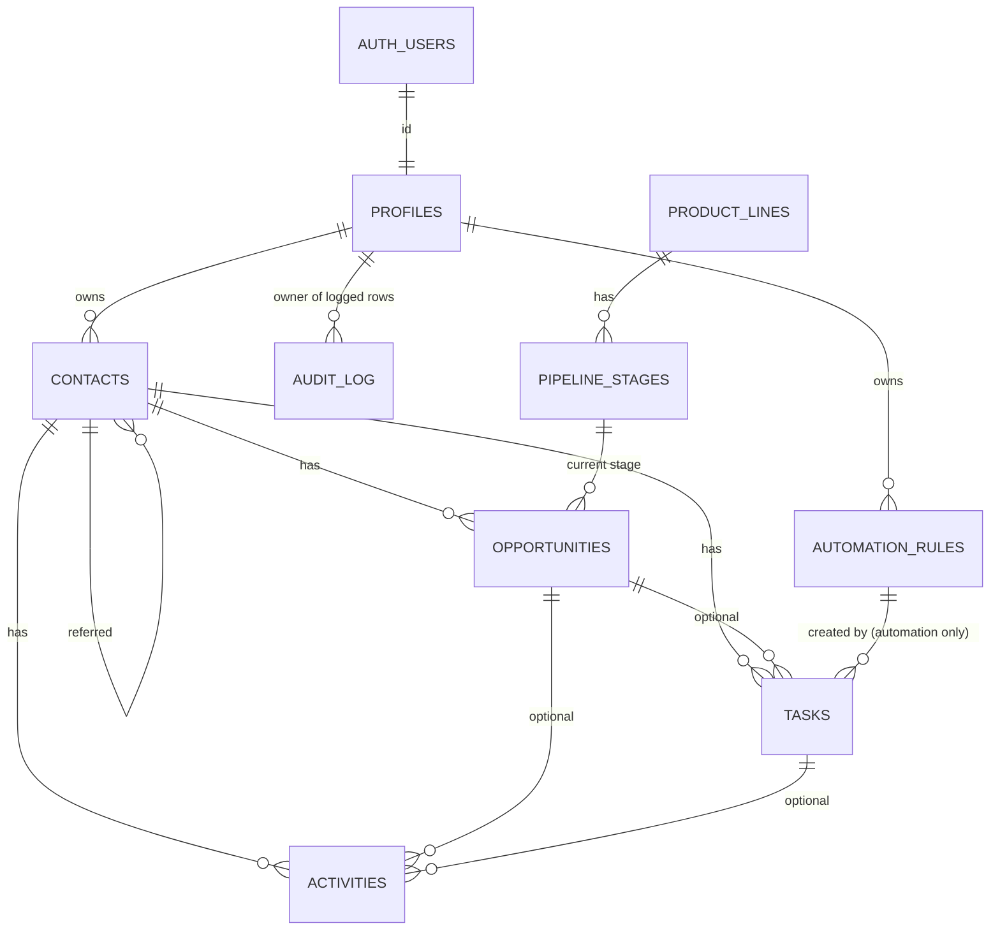

# Data model

Source of truth: `supabase/migrations/`. This page explains it; if they disagree, the
migrations win and this page needs fixing.

## Entity relationships

Every business table carries `owner_id`. Foreign keys between business tables include
`owner_id` (or `contact_id`), so a record can never point at another agent's contact,
or at an opportunity that belongs to a different contact.

## Tables

### profiles
One per authorized user (`id` = `auth.users.id`). `display_name`, `time_zone` (US zones,
default `America/New_York`), `google_review_url` (https only; used in review requests).
Users may edit only those three columns of their own row.
Profiles are created automatically by a trigger when Supabase Auth adds a user (display name
from user metadata, else the part of the email before @), which in turn inserts the 12 default
automation rules. Every table also has a restrictive policy requiring a two-step (aal2)
session (ADR-016).

### product_lines / pipeline_stages (reference data)
Four product lines: auto, home, commercial, life. Stages per line with `position` and
`kind` (`active` | `won` | `lost`), seeded exactly as spec §9 and mirrored in
`src/lib/pipelines.ts`. Read-only for users; changed only by migrations.

### contacts
Individuals and businesses. Name rule: an individual needs a first or last name; a business
needs a business name. Email, phone, address (2-letter state, US ZIP), preferred contact
method, lead source (free text), `relationship_status` (prospect | client | former_client),
`referred_by_contact_id` (another of the same agent's contacts; never itself),
`google_review_left_on` (recorded by the agent), notes (≤ 5,000 chars), `archived_at`
(archive instead of delete).

### opportunities
Many per contact, in any mix of product lines.

| Column | Meaning |
|---|---|
| `product_line`, `stage_id` | Stage must belong to the same product line (composite FK). |
| `stage_kind` | Copied from the stage by trigger; used by the consistency check. |
| `outcome` | `open` / `nurture` on active stages; `won` only on the won stage (Bound, or Placed for life); `lost` only on Lost. |
| `loss_reason`, `loss_reason_detail` | Reason required exactly when the outcome is `lost`. |
| `closed_at` | Set automatically when won or lost; cleared on reopen. |
| `cycle` | Starts at 1; incremented on reopen so a new follow-up sequence gets new task keys. |
| `quote_sent_on`, `estimated_annual_premium`, `quoted_carrier`, `next_action`, `effective_date`, `renewal_date` | Quote tracking and dates. Renewal must be after effective. Carrier is free text (≤ 100). |

Lifecycle rules (trigger `opportunities_b_lifecycle`, Phase 4): the product line cannot change
after creation; `cycle` is set by the database only (1 on insert, +1 when a won or lost
opportunity is reopened, otherwise unchanged); reopening a lost opportunity clears its loss
reason and detail (the audit log keeps them).

A life application in "Application Process" or "Decision Pending" can never be marked won.

### tasks
Contact required; opportunity optional (must belong to the same contact). `due_date` is a
calendar date; optional `start_date` (≤ due date) hides the task from current work until then.
`category` prospecting/onboarding/renewal/review_request/referral_request/other.
`priority` low/normal/high. `status` open/completed/cancelled, with
`completed_at` / `cancelled_at` maintained by trigger. `origin` manual/automation:
automation tasks must carry `automation_rule_id` and `dedupe_key`; manual tasks carry
neither. `(owner_id, dedupe_key)` is unique, so a retried automation event updates the
existing task instead of creating another (ADR-008). `due_date_overridden` marks a date the
owner changed, so automation leaves it alone.

### activities
Contact history: type (call, meeting, note, email, text_message, follow_up, quote,
review_request, referral_request, other); outcomes include review_left, referral_received, declined;
`occurred_at`, optional outcome, optional link to an opportunity and/or task, notes.
`requested_follow_up_on` is allowed only with the outcome `requested_follow_up`.

### automation_rules
Per-user rule configuration, executed in Phase 6: trigger event, action (create task, close
prospecting tasks, create checklist), anchor date (event, requested, renewal), offset in
calendar or business days, task title, priority, task category, completion window (days
from start to due), cooldown (don't repeat for the same contact within N days), enabled
flag, JSON config (e.g. message templates).

| Default rule | Trigger | Timing |
|---|---|---|
| new_lead_initial_contact | opportunity created | same day |
| contacted_no_quote_follow_up | contacted, no quote | +2 business days |
| quote_sent_follow_up | quote sent | +3 calendar days |
| requested_follow_up | prospect asked for a date | that date |
| no_response_follow_up | no response | +5 calendar days (asks first) |
| won_close_prospecting / won_onboarding_checklist | won | same day |
| lost_close_prospecting | lost | same day |
| renewal_review | renewal date known | 60 days before renewal |
| reopened_restart | reopened | same day |
| review_request | won (once per contact) | starts +1 day, due 30 days later; not within 365 days; never after a review is recorded |
| referral_request | won (once per contact) | starts +1 day, due 30 days later; not within 365 days |

### audit_log
Append-only, written by trigger on contacts, opportunities, tasks, activities and
automation_rules: actor, table, record, action, and for updates only the changed columns.
Readable by the record's owner; nobody can write to it through the API.

## Database functions (Data API)

Called by signed-in users through RPC. All are SECURITY INVOKER with an empty `search_path`,
so row level security (including the two-step requirement) filters every row; EXECUTE is
granted to `authenticated` only.

| Function | Purpose |
|---|---|
| `search_contacts(query, type, status, lead_source, archived, sort, limit, offset)` | Contact list: name (either order), business, email (escaped ILIKE) or phone digits (≥ 3); filters; sort `name` / `recent` / `updated`; limit capped at 100. |
| `find_possible_duplicates(email, phone, exclude_id)` | Up to 5 contacts with the same email (case-insensitive) or the same last 10 phone digits (phone or alt phone), archived included. |
| `contact_lead_sources()` | Lead sources already used, one per case-insensitive spelling (the first one used). |
| `search_opportunities(query, product_line, outcome, stage_id, closed, sort, limit, offset)` | Board and table: opportunities with stage name/position and contact name; search over contact name, business, description, carrier; `closed` = `all` / `none` / `recent` (open + closed in 30 days); sort `updated` / `created` / `name` / `premium` / `renewal`; limit capped at 200. |

## Deletion and history

No foreign key cascades. The API roles have no DELETE privilege on any table: contacts are
archived, opportunities closed, tasks completed or cancelled, and activities kept. A user
who owns CRM records cannot be removed from `auth.users` without first dealing with their
data (deliberate safeguard).

## Dates and time zones

`date` columns hold calendar dates with no time zone (due dates, quote, effective and
renewal dates). `timestamptz` columns hold instants. The app computes "today" in the user's
`time_zone` (Phase 5).
