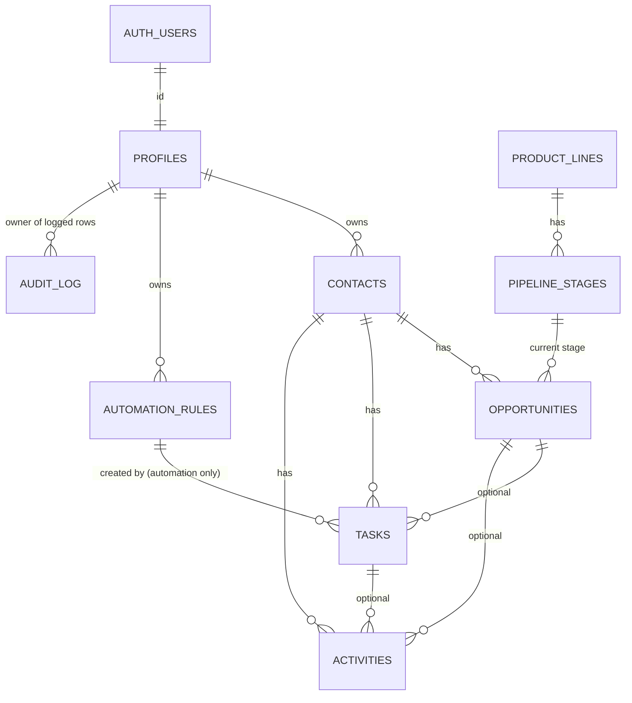

# Data model

Source of truth: `supabase/migrations/`. This page explains it; if they disagree, the
migrations win and this page needs fixing.

## Entity relationships

Every business table carries `owner_id`. Foreign keys between business tables include
`owner_id` (or `contact_id`), so a record can never point at another agent's contact,
or at an opportunity that belongs to a different contact.

## Tables

### profiles
One per authorized user (`id` = `auth.users.id`). `display_name`, `time_zone` (US zones,
default `America/New_York`). Users may edit only those two columns of their own row.
Creating a profile inserts the 10 default automation rules for that user.

### product_lines / pipeline_stages (reference data)
Four product lines: auto, home, commercial, life. Stages per line with `position` and
`kind` (`active` | `won` | `lost`), seeded exactly as spec §9 and mirrored in
`src/lib/pipelines.ts`. Read-only for users; changed only by migrations.

### contacts
Individuals and businesses. Name rule: an individual needs a first or last name; a business
needs a business name. Email, phone, address (2-letter state, US ZIP), preferred contact
method, lead source (free text), `relationship_status` (prospect | client | former_client),
notes (≤ 5,000 chars), `archived_at` (archive instead of delete).

### opportunities
Many per contact, in any mix of product lines.

| Column | Meaning |
|---|---|
| `product_line`, `stage_id` | Stage must belong to the same product line (composite FK). |
| `stage_kind` | Copied from the stage by trigger; used by the consistency check. |
| `outcome` | `open` / `nurture` on active stages; `won` only on the won stage (Bound, or Placed for life); `lost` only on Lost. |
| `loss_reason`, `loss_reason_detail` | Reason required exactly when the outcome is `lost`. |
| `closed_at` | Set automatically when won or lost; cleared on reopen. |
| `cycle` | Starts at 1; incremented on reopen so a new follow-up sequence gets new task keys. |
| `quote_sent_on`, `estimated_annual_premium`, `next_action`, `effective_date`, `renewal_date` | Quote tracking and dates. Renewal must be after effective. |

A life application in "Application Process" or "Decision Pending" can never be marked won.

### tasks
Contact required; opportunity optional (must belong to the same contact). `due_date` is a
calendar date. `priority` low/normal/high. `status` open/completed/cancelled, with
`completed_at` / `cancelled_at` maintained by trigger. `origin` manual/automation:
automation tasks must carry `automation_rule_id` and `dedupe_key`; manual tasks carry
neither. `(owner_id, dedupe_key)` is unique, so a retried automation event updates the
existing task instead of creating another (ADR-008). `due_date_overridden` marks a date the
owner changed, so automation leaves it alone.

### activities
Contact history: type (call, meeting, note, email, text_message, follow_up, quote, other),
`occurred_at`, optional outcome, optional link to an opportunity and/or task, notes.
`requested_follow_up_on` is allowed only with the outcome `requested_follow_up`.

### automation_rules
Per-user rule configuration, executed in Phase 6: trigger event, action (create task, close
prospecting tasks, create checklist), anchor date (event, requested, renewal), offset in
calendar or business days, task title, priority, enabled flag, JSON config.

| Default rule | Trigger | Timing |
|---|---|---|
| new_lead_initial_contact | opportunity created | same day |
| contacted_no_quote_follow_up | contacted, no quote | +2 business days |
| quote_sent_follow_up | quote sent | +3 calendar days |
| requested_follow_up | prospect asked for a date | that date |
| no_response_follow_up | no response | +5 calendar days (asks first) |
| won_close_prospecting / won_onboarding_checklist | won | same day |
| lost_close_prospecting | lost | same day |
| renewal_review | renewal date known | 60 days before renewal |
| reopened_restart | reopened | same day |

### audit_log
Append-only, written by trigger on contacts, opportunities, tasks, activities and
automation_rules: actor, table, record, action, and for updates only the changed columns.
Readable by the record's owner; nobody can write to it through the API.

## Deletion and history

No foreign key cascades. The API roles have no DELETE privilege on any table: contacts are
archived, opportunities closed, tasks completed or cancelled, and activities kept. A user
who owns CRM records cannot be removed from `auth.users` without first dealing with their
data (deliberate safeguard).

## Dates and time zones

`date` columns hold calendar dates with no time zone (due dates, quote, effective and
renewal dates). `timestamptz` columns hold instants. The app computes "today" in the user's
`time_zone` (Phase 5).
